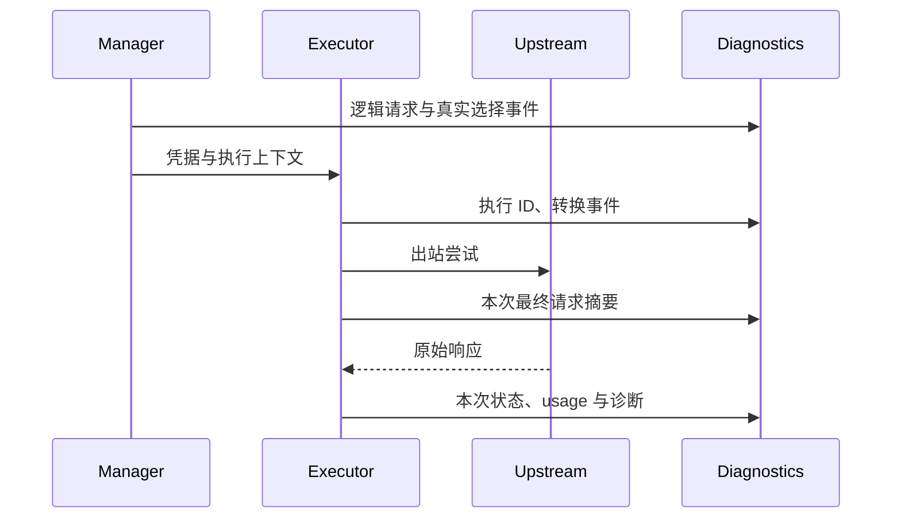

# 缓存往返与诊断契约

## 首期范围

原厂 Responses 出口保留其控制项和响应信息；Codex、SIWC 和 Chat Completions 的兼容行为按实际出口区分。账号调度、故障转移、LCP 和 OAuth 严格前缀采用规则保持既有语义。

诊断记录描述实际执行过的操作，不通过旁路检索制造候选。已知请求之间的差异比较与上游官方比较独立呈现。客户端配置更新时间线、独立内容索引和全局内存树不属于首期。

## 所有者与关联

- Auth Manager 拥有本实例的有界诊断记录和逻辑请求标识。执行 metadata 的 request ID 与用量记录的 request ID 分开保存。
- 选择决定在真实分支记录。插件 selection ID 可选，不把它当作所有选择路径都有的主键。
- UsageReporter 拥有执行记录及出站尝试序号。每次发送绑定自己的凭据、最终请求摘要、上游结果；后续尝试不得覆盖早先的证据。
- 翻译器调用边界记录字段变化；没有分支证据时只报告入口/出口差异。
- Management 提供受现有管理鉴权保护的只读查询；Panel 使用同一数据，不重跑匹配算法。

## 记录边界

记录只含配置枚举、计数、字段存在性和摘要。PCK、会话/调用方标识和内容使用不可逆摘要；不保存 prompt、Authorization、Cookie、凭据或原始响应正文。

记录同时限制请求数、事件数、尝试数和字节量。截断显式标记；查询不续期、不改变绑定或匹配排序。历史诊断与算法索引的生命周期独立；当前没有对象不能推断该对象曾经过期。

更新超过单条字节上限时，丢弃整次更新并标记截断，保留更新前的字段和更新时间。

## 缓存用量

原有数值字段保持兼容。新增版本化观测信息区分缓存读取/写入字段的有效数值、字段缺失和未知。零值只有在原始响应确实提供有效的零时才是明确零；协议兼容填充不可冒充上游值。旧记录缺少观测信息时保持未知。

观测信息经过 SDK usage、内存统计、导入导出和 usage queue 保留，不改变 token 总量、计费口径或去重身份。

## 官方诊断

分别记录最终比较 ID 是否发送、上游是否返回诊断对象以及原始诊断类型。

| 类型 | 含义 |
| --- | --- |
| `cache_hit` | 对该基线未检测到损失，实际读取量另看 usage |
| `cache_miss` | 对该基线报告损失；原因不是唯一根因保证 |
| `comparison_response_not_found` | 比较记录不可用，可能缺失或过期 |
| `unavailable` | 本次没有可用结论，不直接表示不支持 |

Panel 事后切换本地比较对象，不会补出另一份官方诊断。使用真实上游 Responses ID；Chat 转换生成的 ID 不被当作官方基线。

## 指定会话查询

返回当前绑定、相关前缀轨迹的有限摘要、所属实例和采集时间。内置会话亲和选择器返回 `bound`、`unbound` 或 `ambiguous`。插件宿主已启动但没有活动调度插件时，仍可查询这些绑定。其他选择器或活动调度插件返回 `unsupported`。通过专用快照复制必要元数据，不调用会刷新 TTL/LRU 的 Match，不逐行重复全表 lookup。

## 验收

1. 有明确身份但未绑定：记录未执行 LCP，而不是 LCP miss。
2. 当前索引没有候选：不记录一个未被算法查看过的拒绝对象。
3. A 失败后 B 成功：选择、发送和缓存结果按尝试关联。
4. 缓存读取零、正值、缺失和旧记录未知能够分别往返。
5. 原厂 Responses 请求控制项、普通响应和 SSE 终态保留；Codex/SIWC 原有兼容回归通过。
6. 诊断请求与返回状态独立，比较不可用不误标为一定过期或不支持。
7. 查询不影响有效绑定、TTL、访问排序；容量/字节超限有截断标记。
8. 旧导出可导入、旧客户端可读取原字段；新 Panel 连接旧 Core 显示能力不可用。

真实模型缓存收益需要另行受控验收。本地模拟上游只验证协议、关联和统计正确性。

## 出口与客户端范围

| 实际出口 | 首期行为 |
| --- | --- |
| API key + `https://api.openai.com/v1` | 使用 Responses 请求转换；保留 `prompt_cache_options`、breakpoint、`generate`、`previous_response_id`、`store`、输出预算和位置配置更新。沿用调用方显式 PCK，缺省时不从会话自动补 PCK |
| OAuth 的 Codex／SIWC | 保留既有字段适配和亲和策略，记录实际分支及字段变化 |
| 自定义 API key 反代地址 | 沿用原兼容策略；不能只凭 `codex` provider 名判断它具备原厂能力 |
| Chat Completions 上游 | 缓存写入量和 TTL 明细映射到 Responses；既有流式缺省读取零仍输出，同时记为转换器兼容默认值 |

下游名称不参与原厂判断。Codex、ZCode 或其他客户端只要进入同一个实际出口，就遵守该出口规则；入口格式单独保存在记录中。客户端原生配置事件不会由 CPA 自动合成。

Responses／Codex 入口已有 Responses 请求形状，原厂出口保留其控制字段；Chat Completions、Claude 和 Gemini 入口继续通过已有 Codex 请求转换器生成 `input`，随后应用原厂出口规则。

`configuration_update` 与自动 compaction 的组合在公共 Responses 入口允许，在会删除 `context_management` 的 Codex 转换步骤拒绝；自动 truncation 和独立 `/responses/compact` 的限制仍保留。HTTP 执行器继续使用 SSE 向上游请求，并按下游模式输出 JSON 或 SSE。

## 查询 API 与生命周期

使用既有 Management 鉴权，路径均在 `/v0/management`：

- `GET /cache-diagnostics/capabilities`：版本、记录开关、本实例 ID、保存数量与序列化 JSON 字节。
- `GET /cache-diagnostics/requests/:id` 返回逻辑请求的入口摘要、事件和发送尝试。可传 `instance_id` 校验来源。无可用记录时返回 404。
- `GET /cache-diagnostics/traces` 使用 `trace_search_version: 1`。省略参数可浏览近期请求，`q` 精确查找执行、日志、诊断、逻辑请求或上游响应 ID。重复 ID 返回多个候选。也支持 `instance_id`、`kind/digest/scope`、`from_ms/to_ms`、`focus` 和 `limit/cursor`。可用焦点为 `zero_read`、`retry`、`official_loss`。默认 30 条，最大 100 条。快照失效返回 409。
- 精确 ID 及关联检索也覆盖可用的用量历史。仅有历史用量时条目标为 `available: false`。历史行的 `history_key` 标识当前实例用量快照中的行。只有同一出站作用域的已完成响应被明确引用，且前序唯一时，返回 `previous` 和 `previous_source`。Claude 进一步核对凭据，优先使用实际出站的 `thread.previous_message_id`，其次使用 `diagnostics.previous_message_id` 作为上游比较引用。
- `POST /cache-diagnostics/session`：只读查询；请求包含 `provider`、`model`、64 位十六进制 `session_hash`，可带 `diagnostics_id` 读取最近一次已记录 OAuth 决定对应的作用域。请求体上限 4 KiB。

`usage-statistics-enabled` 控制新增诊断记录。每个 Manager 实例最多保存 512 条，单条最多 128 个事件、32 次发送、64 KiB；保存的序列化 JSON 总量最多 8 MiB，最后更新后保留 1 小时。容量淘汰和过期均使详情不可用；404 无法单独证明是哪种原因。单个请求摘要扫描上限 32 MiB，响应 JSON／SSE 行上限 2 MiB，超限显示不完整证据。

账号绑定/LCP 快照最多 64 行，OAuth 快照另外最多 64 行。OAuth 查询仅根据该请求实际记录的作用域和明确身份执行；没有身份时返回 unavailable。查询不创建索引、不更新访问顺序、不清理过期对象。返回仍留在内存的过期对象时标记 expired；已被清理的对象无法据此还原。

用量记录新增 `request_id`（现有执行 UUID）、`diagnostics_id` 与 `diagnostics_instance_id`。Panel 必须核对实例 ID，避免旧导入数据或服务重启后错误关联。事件携带 `decision_id` 和可取得的 `execution_id`；插件 `selection_id` 仍可选。每次传输携带同一个决定 ID 和该执行 UUID。`body_consumed` 只表示 HTTP 响应体读完，HTTP 状态、模型响应状态和用量分别呈现。

请求/响应压缩观察使用既有传输的副本或解码后已消费数据，不额外预读流。WebSocket 记录实际发送帧与复用连接的会话 header 摘要；发送失败和重发分别保存。未取得可解析响应时，官方诊断显示未观察，而非断言上游没有返回。

诊断事件保留在单实例内存，重启后由实例 ID 区分。面板本地比较使用两条入口 JSON 摘要，出站详情展示入口到各次发送的差异。

内容摘要覆盖 Responses 的 `input`、Chat／Claude 的 `messages` 与 `system`、Gemini 的 `contents` 与系统指令、相关推理配置，以及 Gemini CLI 的 `request` 包装、Claude 的 `thread.previous_message_id` 与 `diagnostics.previous_message_id`。内容字段仅保存摘要，连同配置子字段最多 32 项；重复字段或超出扫描上限时标记证据不可用。

同一 WebSocket 长连接的后续 create/append 复用账号选择，每次客户端 create 各有执行 ID、准备阶段输入摘要和发送记录。无对应客户端发送的自动 successor 只记录 `no_client_dispatch` 事件，不捏造发送尝试。steering 控制帧与服务端自动响应的完整因果图留待后续扩展。

WebSocket 响应在确定执行归属后记录诊断，模型观察不隐式改写发送证据。无法归属的连接错误记录为连接事件，不改写已完成的尝试；普通错误和凭据拒绝均遵循这个边界。`response.done` 与 `response.completed` 都作为完成终态；没有 usage 的终态仍保留响应状态和观察结果。

## 用量查询扩展

用量能力声明 `cache_observation_version: 1` 和 `cache_route_version: 1`。

- 读写分别接受 `cache_read_state`、`cache_write_state`，取值为 `positive`、`zero`、`unknown`。筛选、分页、查询导出共用快照与条件。
- 分析接口在窗口、小时、日桶返回 `observed`。读写各有三类计数。比例使用上游读数有效、输入为正且读数不超过输入的同一批记录。分母为零时返回空值。
- `cache_route` 版本 1 随 canonical v3 用量和 queue 保存关联与已观察的尝试。类型包含输入会话、出站会话、PCK、本地严格前缀组、命名缓存。精确过滤使用类型、完整摘要和作用域。作用域由实例、调用方及已知的真实出站地址组成，本地组还沿用算法记录的作用域。匹配字段保留实际出站证据，缺少作用域的标识仅供显示。

Meta 实际发送的 `X-Tbh-Session-Id` 以出站会话摘要记录。官方损失焦点使用 `cache_miss` 或上游回报的正数 `cache_missed_tokens`。比较记录不可用和诊断不可用各自保留原状态。
